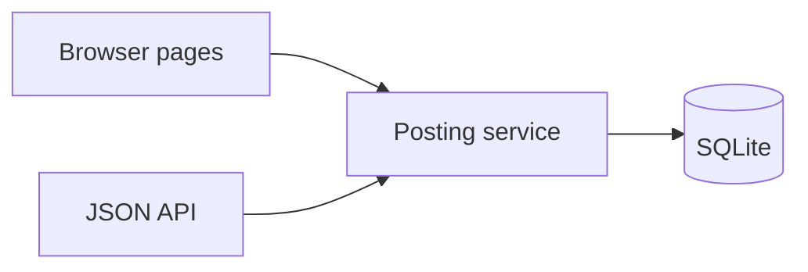

# Architecture

Linden Ledger is one Flask process. The pages and the JSON API call the same posting service. That service talks to SQLite only through parameterized SQL.

Money is an integer number of fen. A transfer writes the sender debit and the receiver credit in one `BEGIN IMMEDIATE` transaction. A failure rolls the whole transaction back. There is no overdraft.

The visible name is Linden Ledger. The session cookie is still `chengbu_session` so existing clients keep a stable name. A banking session lasts 30 minutes. Changing a passphrase replaces `password_changed_at`, and any session whose stamp does not match is signed out.

Each demo account has its own passphrase. Only an Argon2id hash is stored. Sign-in always runs a hash verification, including when the username is missing, and five failures lock that account. The pictures on the pages are original artwork stored in the repository. They are not payment-scheme marks. See `docs/assets.md`.

The posted-balance line on the overview is drawn from the signed-in account's own ledger entries. It is not a forecast. It is hidden when the account has only the opening entry, because a single point is not a useful line.
